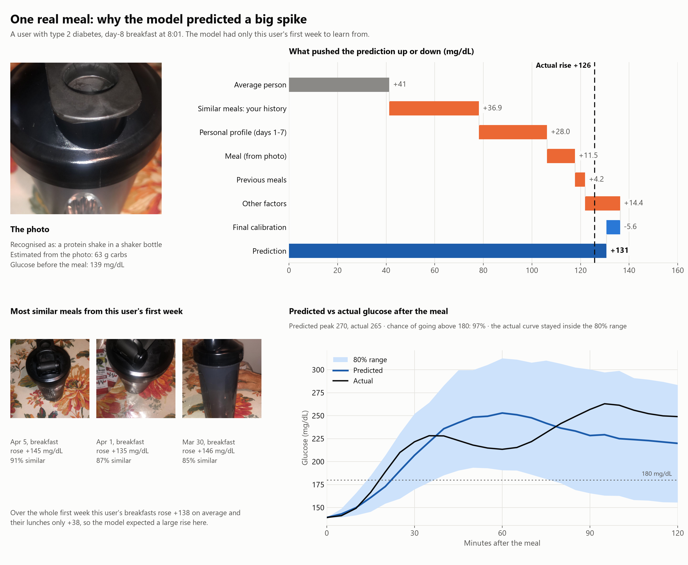
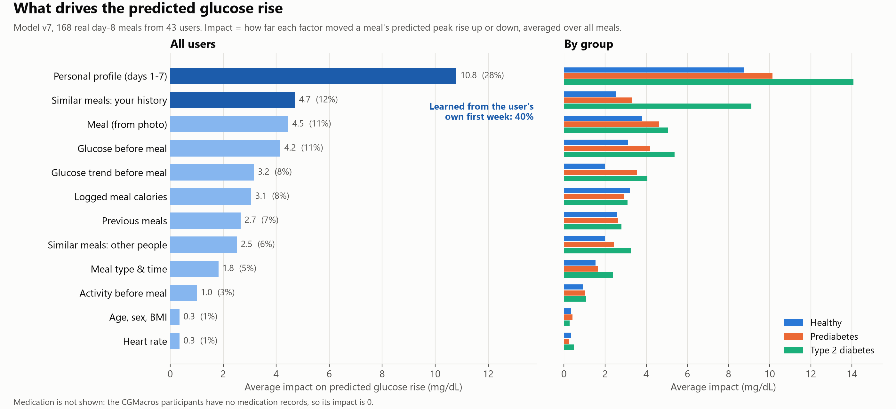
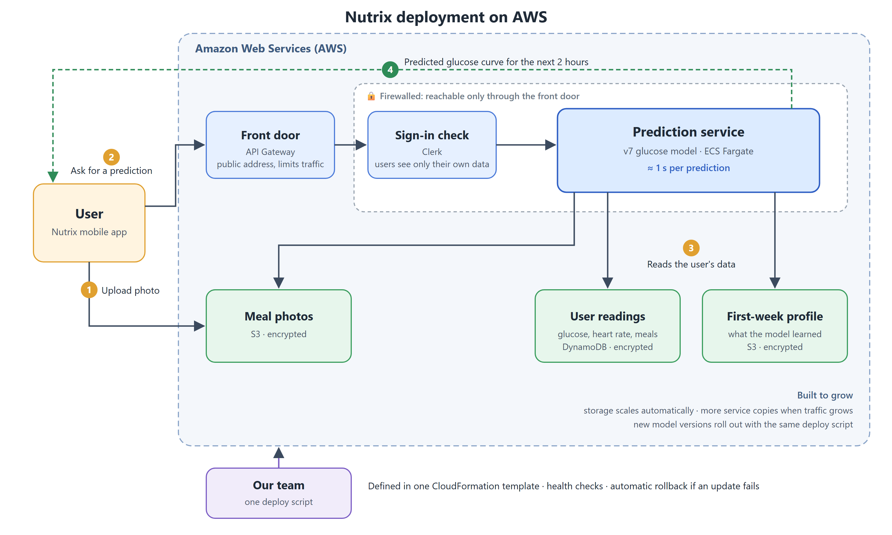

<h1 align="center">Nutrix</h1>

<p align="center"><b>Snap a photo of your meal. See what it will do to your blood sugar before you eat it.</b></p>

<p align="center">
  <a href="https://github.com/doublehan2023/Nutrix/actions/workflows/ci.yml"></a>
  
  
  <a href="LICENSE"></a>
</p>

Nutrix predicts a person's glucose curve for the two hours after a meal, from a photo of the meal and their own data.
It learns how each body responds from the user's first week of continuous glucose (CGM), heart-rate and meal data,
so the same plate gets a different prediction for different people.

Built at Rutgers Health Hack 2026 (Wellness Reimagined, Challenge #3).

## What you get for every meal

- **The glucose curve** for the next two hours, with an 80% range: glucose at 30, 60, 90 and 120 minutes, the peak and
  when it happens
- **The risk of a spike**: the chance of going above 140 and 180 mg/dL
- **What the photo shows**: recognised food and estimated carbs, protein, fat and calories
- **Why**: the factors that pushed the prediction up or down, and the user's own past meals that looked most alike
- **What if**: the same meal with half the carbs, extra protein or fiber, or a double portion
- **How sure the model is**, with plain-language reasons when it is less sure

<p align="center"></p>

## How it works

1. **Learn the person (days 1–7).** From the first week the model builds a personal profile: how much this user's
   glucose usually rises, how strongly it reacts to carbohydrate, their typical glucose and resting heart rate.
2. **Read the meal.** A photo model (MobileCLIP-S2) recognises the food and estimates its nutrition.
3. **Predict.** Two models are combined: a LightGBM model that weighs the meal, the glucose and heart rate just before
   it, earlier meals, activity and the personal profile; and a transformer that reads the user's first-week glucose
   curves directly, so a new user needs no retraining.

On 168 real day-8 meals from 43 study participants, the predicted rise in glucose was off by 17.5 mg/dL on average
(median 12.2), against 29.0 for predicting the average rise every time. Factors learned from the user's own first week
account for 40% of what drives a prediction, more than the meal itself.

<p align="center"></p>

## Architecture

The prediction service runs on AWS, defined in one CloudFormation template and deployed with one script.

<p align="center"></p>

- **API Gateway** is the one public entry point and limits traffic.
- The service runs as a container on **ECS Fargate** behind an internal load balancer; firewall rules let nothing else
  reach it.
- Mobile users sign in with **Clerk**; the service checks each sign-in, so users only reach their own data.
- Readings live in **DynamoDB**, photos and first-week profiles in **S3**, all encrypted.
- Health checks gate every release, and a failed release rolls back automatically.

Request path, data layout and security boundaries: [docs/architecture.md](docs/architecture.md).

## Application architecture

The mobile client is an Expo / React Native app in [`mobile/`](mobile/) using Expo Router and Clerk. The app keeps
navigation, short-lived UI state and API communication separate so patient and clinician experiences can evolve
independently.

```text
Clerk session
     │
     ▼
AuthProvider ── role + assigned demo participant
     │
     ├── Patient ── questionnaire → Today / History / Insights / Settings
     │                    │
     │                    └── meal photo → meal draft → prediction result
     │
     └── Clinician ── patient directory / clinician settings
                            │
                            └── read-only patient detail

Patient API calls ── Clerk bearer token ──> mobile gateway ──> prediction service and storage
```

### Mobile client

- [`mobile/src/app/`](mobile/src/app/) contains file-based routes. The root stack protects routes by Clerk role:
  patients receive the four-tab patient app and its meal, profile and prediction flows; clinicians receive a separate
  two-tab directory and settings shell.
- [`mobile/src/auth/`](mobile/src/auth/) turns the Clerk user and public metadata into the app's role and optional
  CGMacros participant ID. It is the single source for sign-in state, sign-out and API session tokens.
- [`mobile/src/features/`](mobile/src/features/) owns session-only state: the health questionnaire, meal draft,
  language selection and Senior Mode accessibility theme. These values are held in app memory rather than persisted to
  the backend.
- [`mobile/src/components/`](mobile/src/components/) holds reusable feature components for history, insights, meals,
  predictions, profiles, settings and clinician views. [`mobile/src/data/`](mobile/src/data/) supplies the local demo
  histories and clinician directory data used by the prototype screens.
- [`mobile/src/api/gateway.ts`](mobile/src/api/gateway.ts) is the only mobile API client. It attaches the Clerk bearer
  token, obtains a presigned image-upload URL, uploads the normalized meal photo, and requests readiness or prediction
  data.

### Request and data flow

1. A patient signs in through Clerk. The app resolves the role from public metadata and routes to the appropriate
   protected shell.
2. For a meal prediction, the app captures or selects a photo, normalizes it locally to JPEG, creates a session-only
   meal draft, and uploads the photo through a presigned storage URL.
3. The gateway validates the Clerk JWT, verifies the assigned participant and role, then calls the existing prediction
   service against that person's stored CGM, heart-rate and meal history.
4. The API response supplies the predicted curve, confidence, nutrition estimate and explanation used by the prediction
   result screen. History, insights and clinician-directory data are currently local demo presentation data unless a
   screen explicitly calls the gateway.

## Getting started

**Prerequisites:** AWS CLI with credentials, Docker, Python 3.11, Node.js (mobile app), a Clerk account. The study
datasets and trained model files are stored in S3, so the download steps need access to that AWS account.

**1. Install**

```bash
git clone https://github.com/doublehan2023/Nutrix.git && cd Nutrix
pip install -r requirements.txt     # all Python packages
cp .env.example .env                # fill in the Clerk settings
set -a; . ./.env; set +a            # load the settings for the scripts below
./ops/data/sync_data.sh pull        # study datasets from S3 -> data/
./scripts/fetch_model.sh            # trained model files from S3, checked against their checksums
```

**2. Run locally (optional)**

```bash
./scripts/build.sh                  # service image pmrf-api:<model version>
docker run --rm --cpus 2 --memory 4g -p 8080:8080 -e PMRF_API_KEY pmrf-api:$MODEL_VERSION
curl localhost:8080/healthz
```

**3. Deploy to AWS**

```bash
./scripts/deploy.sh
```

Builds the image, pushes it to ECR, creates or updates the CloudFormation stack, waits for the new version to pass
its health checks and prints the API address. The image is tagged with the model version and the git commit, so
commit first. The first deploy takes about 10 minutes; `SKIP_BUILD=1` reuses a local model image. A new AWS account
needs, once: the model files in an S3 bucket (`scripts/fetch_model.sh` reads `s3://nutrix-models/models/<version>/`), an
S3 bucket for meal photos (template parameter `PhotoBucket`), and free bucket names (S3 names are global;
`nutrix-person-state` is set in `infra/pmrf.yaml`).

**4. Onboard users**

```bash
python -I ops/data/onboard_patients.py <api-url> data/CGMacros <ids...>
```

Uploads each user's first week (meal photos, CGM, heart rate, activity) and builds their personal profile. For the
demo users, CGMacros study participants `cgmacros-<id>`, it also loads their later readings, which stand in for the
live readings a real user's sensor would send.

**5. Predict a meal from a photo**

```bash
./scripts/predict.sh <user-id> <photo.jpg> <meal time>
# e.g. ./scripts/predict.sh cgmacros-003 lunch.jpg 2020-03-18T12:30:00
```

The model uses the glucose readings from just before the meal, so for demo users the meal time falls within their
study dates. The app makes the same call through the API: [docs/api.md](docs/api.md).

**6. Mobile app**

```bash
cd mobile
npm ci
cp .env.example .env
npx expo start
```

### Configure the mobile app

1. In `mobile/.env`, set the public values for your Clerk application and deployed gateway:

   ```env
   EXPO_PUBLIC_CLERK_PUBLISHABLE_KEY=pk_test_...
   EXPO_PUBLIC_NUTRIX_API_URL=https://your-api-gateway.example.com
   ```

   These values are bundled into the app. Do **not** put `CLERK_SECRET_KEY`, `PMRF_API_KEY`, AWS credentials or any
   other server secret in `mobile/.env`.

2. In Clerk, enable Native API support plus email/password sign-in and email-code verification. Configure the session
   token template to include the `role` and `pmrf_person_id` claims consumed by the mobile gateway.

3. In the root `.env`, configure the matching `CLERK_JWT_ISSUER`, `CLERK_JWT_AUDIENCE` and
   `MOBILE_DEMO_PERSON_IDS` values before deploying or running the gateway locally.

4. Start Expo with `npx expo start`, then choose an iOS simulator, Android emulator, Expo Go, or web target from the
   development server. Patient users can sign up directly; clinician and admin roles must be assigned by a trusted
   process in Clerk.

For staff-role provisioning, the trusted patient-role webhook and the full Clerk setup, see
[docs/mobile_setup.md](docs/mobile_setup.md).

## Tests

```bash
./scripts/test.sh                          # static checks, the same as CI
./scripts/test_integration.sh <api-url>    # end-to-end flow against a running service + unseen hospital meal photos
```

GitHub Actions runs the static checks and a Docker build on pull requests. More on testing the deployed API:
[docs/testing_api.md](docs/testing_api.md).

## Repository layout

| Path | What |
| --- | --- |
| `mobile/` | Expo / React Native app with Clerk sign-in |
| `services/clerk-role-webhook/` | Lambda that gives new sign-ups the patient role |
| `model/` | Model code, FastAPI service, Dockerfile, model docs ([model/README.md](model/README.md)) |
| `server/` | AWS layer on the model service: person data on DynamoDB + S3, mobile sign-in gateway |
| `infra/` | CloudFormation stack (API Gateway, load balancer, ECS Fargate, DynamoDB, S3) |
| `scripts/` | Build, deploy, predict and test entry points |
| `ops/data/` | Dataset sync with S3, user onboarding, test-photo selection |
| `tests/integration/` | Tests against a running service: day-8 meals of the onboarded users, unseen hospital meal photos |
| `docs/` | [API reference](docs/api.md), [architecture](docs/architecture.md), [testing the API](docs/testing_api.md), [mobile setup](docs/mobile_setup.md) |

## Data

Development and evaluation use the [CGMacros](https://physionet.org/content/cgmacros/) dataset (PhysioNet): continuous
glucose, heart rate, activity and meal photos with logged nutrition from people who are healthy, have prediabetes or
type 2 diabetes. The meal photos in this README come from that dataset. Other training data: [model/README.md](model/README.md).

## License

[MIT](LICENSE)
