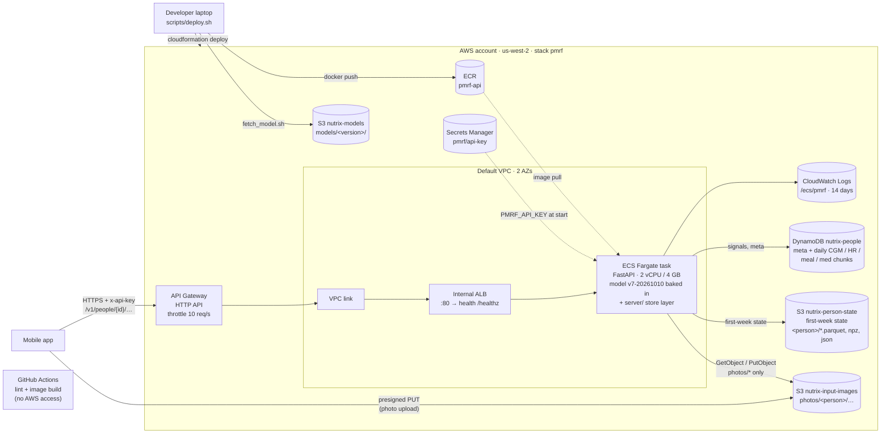

# Deployment architecture

The PMRF prediction service runs on AWS (us-west-2) as one CloudFormation stack, `infra/pmrf.yaml`, deployed with
`scripts/deploy.sh`. The service code is in `model/service/`; the AWS image adds one layer,
`server/`, that keeps person data on DynamoDB + S3 instead of files.

## Request path

1. The app asks the service for a presigned URL (`POST /v1/people/{id}/photos/upload-url`) and uploads the meal photo
   straight to S3; the photo never passes through API Gateway.
2. The app calls `POST /v1/people/{id}/predict` with the photo key and meal time. API Gateway forwards it over the
   VPC link to the internal ALB, which sends it to a Fargate task.
3. The task reads the photo from S3, the person's recent CGM and heart rate from DynamoDB and their first-week state
   from S3, runs the model and returns the predicted glucose curve.

## Person data

`server/store.py` (`DynamoPersonStore`) implements the same methods as the file-based
`pmrf.state.PersonStore`; `server/app.py` swaps it in at start-up, so nothing in `model/` changes.

| Data | Where | Layout |
| --- | --- | --- |
| Meta (start time, person details, model version) | DynamoDB `nutrix-people` | `pid`, `sk = "meta"`; also the time of the last CGM write |
| CGM, heart rate, meals, medication | DynamoDB `nutrix-people` | `pid`, `sk = "sig#<kind>#<YYYY-MM-DD>"`: one day of one signal as parquet bytes (a few KB, far below the 400 KB item limit) |
| First-week state | S3 `nutrix-person-state` | `<pid>/hist.parquet`, `arrays.npz`, `profile.json` (1–3 MB per person, above the DynamoDB item limit). `profile.json` is written last and marks the state as complete |
| Meal photos | S3 `nutrix-input-images` | `photos/<pid>/<uuid>.jpg` |

The table is on-demand, encrypted and has point-in-time recovery. Writes for one person are serialised inside one
container; two containers writing the same person at the same moment could still race (fine with one app client per
person; conditional writes would close it).

## Security boundaries

| From | To | Allowed |
| --- | --- | --- |
| Internet | ALB, tasks | Nothing: the ALB is internal; only API Gateway reaches it through the VPC link |
| VPC link | ALB | TCP 80 |
| ALB | Tasks | TCP 8080 |
| Tasks | DynamoDB | Get, put, update, delete, query, batch write on `nutrix-people` only |
| Tasks | S3 | Get and put on `nutrix-input-images/photos/*` and `nutrix-person-state/*` only |

The API key is generated by Secrets Manager and injected into the container at start; it is not in git, the image or
the logs. The service never logs glucose values or photos.

## Deploying and releasing

| Action | How |
| --- | --- |
| Deploy or update | `./scripts/deploy.sh` builds the model image and the `server/` layer, pushes it to ECR as `<model version>-<git sha>` (commit first: the tag comes from the commit), updates the stack and waits for the new task to pass health checks. A failed rollout rolls back automatically (ECS deployment circuit breaker) |
| New model version | Upload it to `s3://nutrix-models/models/<version>/`, then `./scripts/deploy.sh <version>`. First-week states are tied to the model version: re-run `/history` for each person afterwards |
| CI | GitHub Actions runs lint and a Docker build on pull requests; it has no AWS credentials (the event account's credentials are temporary) |
| Tear down | `aws cloudformation delete-stack --stack-name pmrf`. The stack deletes the DynamoDB table; the S3 bucket `nutrix-person-state` must be emptied first or the delete stops there. Buckets created outside the stack and the ECR repository stay |
